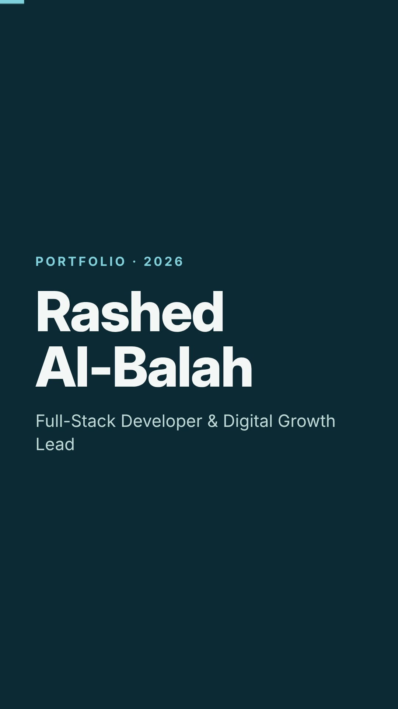

# Rashed Al-Balah · Portfolio

**Full-Stack Developer & Digital Growth Lead.** I build websites, admin dashboards and business systems, and I make sure they bring in customers.

**[View the portfolio →](https://mralbalah.github.io/portfolio/)**



## At a glance

| 25+ | 13+ | 500+ | 3+ |
|---|---|---|---|
| projects delivered | studio clients | clients & visitors generated | years of development |

## Case studies

| Project | What I did | Links |
|---|---|---|
| **The Royal Apparel, Inc.** (USA) | Website, custom admin panel, accounting and purchasing system; lead the design & web team | [Live demo](https://mralbalah.github.io/royal-apparel-demo/) |
| **Root & Restore Nutrition Education** | Website, social media and brand as CMO; 500+ new clients and visitors | — |
| **CodeLine Studio** | Founded a web & brand studio; 25+ projects for 13+ clients | [Site](https://codeline-studio.akgunbalah.workers.dev) · [Code](https://github.com/mralbalah/codeline-studio-website) |
| **CodeLine HQ** | Studio operations dashboard with a demo mode | [Code](https://github.com/mralbalah/codeline-hq) |
| **DeckLine Studio** (California) | 9 deck and house drawing sets in AutoCAD | [Drawings](https://mralbalah.github.io/portfolio/#work) |

## What's in this repo

```
index.html              the portfolio page (GitHub Pages)
assets/img/             screenshots and drawings (client names and addresses removed)
assets/video/           30-second portfolio reel and its cover
```

Plain HTML and CSS, no build step. Works in light and dark mode and on phones.

## Contact

[mralbalah@gmail.com](mailto:mralbalah@gmail.com) · [CodeLine Studio](https://codeline-studio.akgunbalah.workers.dev) · Remote · Worldwide
